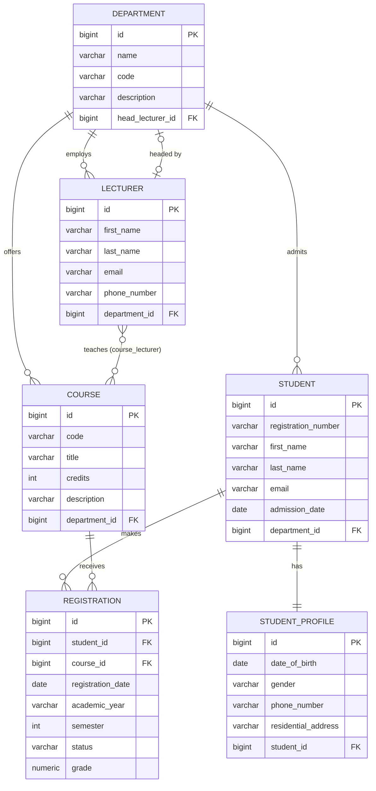

# University Course Registration and Academic Management System

**Course:** Web Technology and Internet — Individual Assignment
**Student Name:** Arsene ISHIMWE KUNDA  **Registration No.:** 28244
**Stack:** Java 17 · Spring Boot 3.3 · Spring Data JPA / Hibernate · PostgreSQL · Maven
**Scope:** Model and Repository layers only

## 1. Problem analysis and identified entities

| Entity | Why it is an entity | Attributes |
|---|---|---|
| **Department** | Independent concept that owns courses, lecturers, students and one head | id, name, code, description, head (FK) |
| **Lecturer** | Staff member employed by a department; teaches courses | id, firstName, lastName, email, phoneNumber, department (FK) |
| **Course** | Offered by one department; taught by lecturers | id, code, title, credits, description, department (FK) |
| **Student** | Admitted into a department | id, registrationNumber, firstName, lastName, email, admissionDate, department (FK) |
| **StudentProfile** | Personal details, exactly one per student | id, dateOfBirth, gender, phoneNumber, residentialAddress, student (FK) |
| **Registration** | Join entity: a student registering for a course, carrying its own data | id, student (FK), course (FK), registrationDate, academicYear, semester, status, grade |

`RegistrationStatus` (PENDING, APPROVED, REJECTED) and `Gender` are enums stored as strings.

## 2. Relationships and cardinality

| # | Relationship | Cardinality | Implemented with |
|---|---|---|---|
| 1 | Department — Lecturer (employs) | 1 : N | FK `lecturers.department_id` |
| 2 | Department — Lecturer (head) | 1 : 1 | FK `departments.head_lecturer_id` (unique) |
| 3 | Department — Course (offers) | 1 : N | FK `courses.department_id` |
| 4 | Department — Student (admits) | 1 : N | FK `students.department_id` |
| 5 | Student — StudentProfile | 1 : 1 | FK `student_profiles.student_id` (unique) |
| 6 | Lecturer — Course (teaches) | M : N | **Join table** `course_lecturer` (no entity) |
| 7 | Student — Course (registers) | M : N | **Join entity** `Registration` (extra attributes) |

- **Foreign keys needed:** relationships 1, 2, 3, 4, 5 (and the two FKs inside the join table/entity).
- **Join table:** Lecturer–Course, because it has no extra data and the assignment says not to create an entity for it.
- **Join entity:** Student–Course, because each registration stores date, academic year, semester, status and grade.

## 3. Entity Relationship Diagram



## 4. Relational schema

```
departments      (id PK, name, code, description, head_lecturer_id FK -> lecturers.id)
lecturers        (id PK, first_name, last_name, email, phone_number, department_id FK -> departments.id)
courses          (id PK, code, title, credits, description, department_id FK -> departments.id)
course_lecturer  (course_id PK/FK -> courses.id, lecturer_id PK/FK -> lecturers.id)
students         (id PK, registration_number, first_name, last_name, email, admission_date, department_id FK -> departments.id)
student_profiles (id PK, date_of_birth, gender, phone_number, residential_address, student_id FK UNIQUE -> students.id)
registrations    (id PK, student_id FK -> students.id, course_id FK -> courses.id,
                  registration_date, academic_year, semester, status, grade)
```

Full DDL: [`docs/schema.sql`](docs/schema.sql)

## 5. How to run

1. Install Java 17+, Maven and PostgreSQL.
2. Create the database: `CREATE DATABASE university_academic_db;`
3. Put your PostgreSQL password in `src/main/resources/application.properties`.
4. Generate tables: `mvn spring-boot:run` (Hibernate creates them via `ddl-auto=update`).
5. Test the mappings and insert sample data: `mvn test`
6. Open pgAdmin / psql, and check the 7 tables (`\dt`) and their keys (`\d registrations`).

## 6. Project structure

```
src/main/java/com/auca/university
 ├─ UniversityAcademicSystemApplication.java
 ├─ model/       Department, Lecturer, Course, Student, StudentProfile, Registration, Gender, RegistrationStatus
 └─ repository/  one JpaRepository per entity
src/test/java/com/auca/university/EntityMappingTest.java
docs/schema.sql
screenshots/    (add your screenshots here)
```
